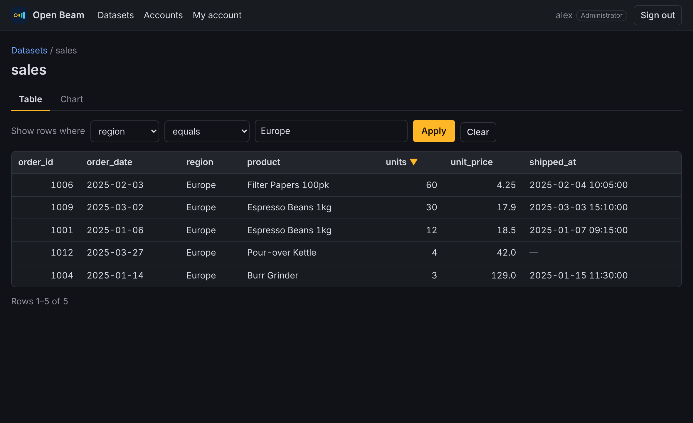
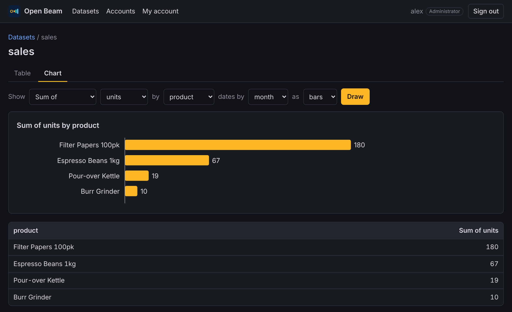
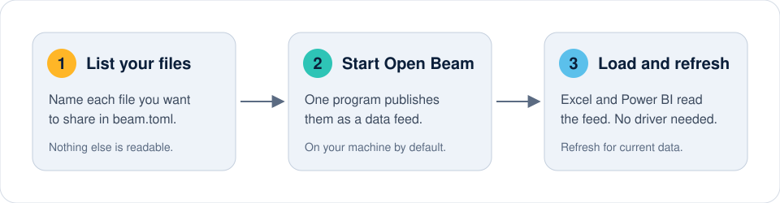
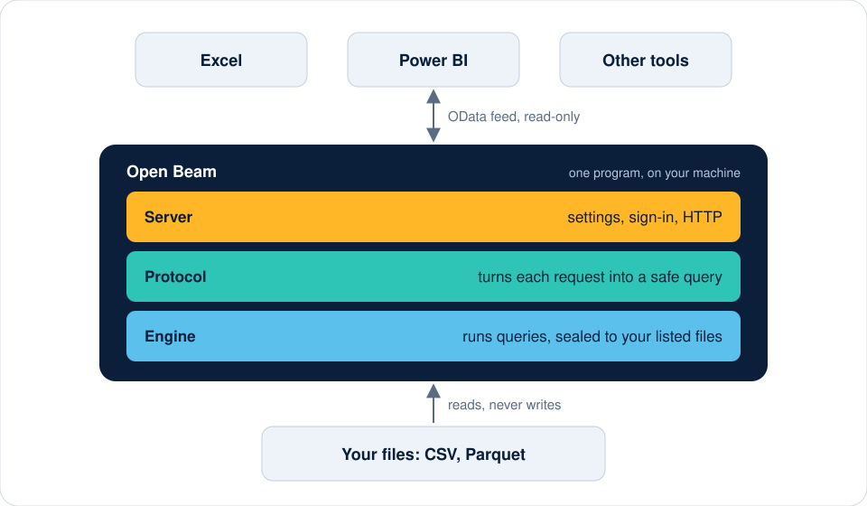

<p align="center">
  
</p>

# Open Beam

Open Beam is an open-source analytics platform written in Rust. It runs as a
single program on your own computer or server, reads the data you point it at,
lets your team explore it in the browser, and makes it available to the tools
you already use, starting with Microsoft Excel and Power BI.

> **Status: early release (0.2).** The web interface, charts, accounts and the
> data feed for Excel and Power BI work and are covered by automated tests.
> Dashboards and database connections are still to come. See the
> [roadmap](docs/ROADMAP.md).

<p align="center">
  
</p>

<p align="center">
  
</p>

## What you get

- **A web interface.** Sign in, browse your datasets, sort, filter and page
  through them. No scripts run in the browser.
- **Charts.** Summarise any dataset as bars or a line: counts, sums and
  averages, grouped by a column or by day, month, quarter or year.
- **Accounts with two roles.** Administrators add people and manage access;
  users read data. See [Manage accounts](docs/guides/05-manage-accounts.md).
- **A data feed for Excel and Power BI.** Load any dataset with the built-in
  OData connector. No driver to install.
- **Clean data in one place.** Define summaries, joins and de-duplicated
  tables once, in SQL, and every report built on them agrees.

## Principles

- **Fast.** Queries run on an embedded columnar engine (DuckDB) inside a
  compiled Rust binary. There is no separate database server to install.
- **Secure by default.** Open Beam listens only on your own machine unless you
  configure otherwise, requires sign-in, reads only the files you list, and
  never modifies them. See [SECURITY.md](SECURITY.md).
- **Your data stays yours.** No telemetry and no hosted service. Data lives
  wherever you keep it, and accounts live in a file on your machine.
- **Educational.** The codebase is small, layered and documented so it can be
  read as a worked example of building a data service in Rust. Start with
  [docs/ARCHITECTURE.md](docs/ARCHITECTURE.md).
- **Extensible.** The engine, protocol and account layers are separate Rust
  crates that other applications can build on.

## How it works

<p align="center">
  
</p>

## Quick start

You need [rustup](https://rustup.rs), which installs the right Rust version
for you, and a C++ compiler. Full instructions for Windows, macOS and Linux are in
[Install Open Beam](docs/guides/01-install.md).

1. Get the code and build it. The first build compiles the DuckDB engine and
   can take 15 minutes or more; later builds take seconds.

   ```bash
   git clone https://github.com/Klydo131/Open-Beam.git
   cd Open-Beam
   cargo build --release
   ```

2. Copy the example configuration. It points at the sample data in
   `examples/`.

   ```bash
   cp beam.example.toml beam.toml
   ```

3. Start Open Beam.

   ```bash
   cargo run --release -- --config beam.toml
   ```

   ```text
   Open Beam 0.2.0 serving 2 dataset(s)
     Open in your browser:        http://127.0.0.1:8787/
     Data feed (Excel, Power BI): http://127.0.0.1:8787/odata/
     No accounts yet. Open the address above to create the administrator.
   ```

4. Open the address in your browser and create the administrator account.

5. To use the data elsewhere, connect a tool to the feed address and sign in
   with **Basic** using your Open Beam username and password.
   - **Excel:** Data → Get Data → From Other Sources → From OData Feed.
   - **Power BI Desktop:** Get Data → OData feed.

## Guides

Step-by-step guides, in order:

1. [Install Open Beam](docs/guides/01-install.md)
2. [Start Open Beam and see your data](docs/guides/02-first-dataset.md)
3. [Connect Excel and Power BI](docs/guides/03-connect-excel-and-power-bi.md)
4. [Combine and clean data](docs/guides/04-combine-and-clean-data.md)
5. [Manage accounts](docs/guides/05-manage-accounts.md)
6. [Run Open Beam for a team](docs/guides/06-run-for-a-team.md)

## Architecture

<p align="center">
  
</p>

Four parts, each with one job. The design and the security model are
explained in [docs/ARCHITECTURE.md](docs/ARCHITECTURE.md).

## Project layout

| Path | Purpose |
| --- | --- |
| `crates/beam-engine` | Embedded query engine: dataset catalog, type mapping, sandboxed execution |
| `crates/beam-odata` | OData v4 protocol: query parsing, SQL planning, metadata |
| `crates/beam-accounts` | Accounts, roles and sessions in a local SQLite file |
| `crates/beam-server` | The `beam` binary: configuration, web interface, data feed |
| `docs/` | Architecture, roadmap and user guides |
| `examples/` | Sample data and a worked reconciliation example |
| `assets/` | Logo and banner |

## Contributing

Contributions are welcome. Please read [CONTRIBUTING.md](CONTRIBUTING.md)
first, and report security issues privately as described in
[SECURITY.md](SECURITY.md).

## License

Open Beam is released under the [MIT License](LICENSE).

Open Beam is an independent project. It is not affiliated with or endorsed by
the Apache Software Foundation or the Apache Beam project, nor by Microsoft.
Excel and Power BI are trademarks of the Microsoft group of companies.
