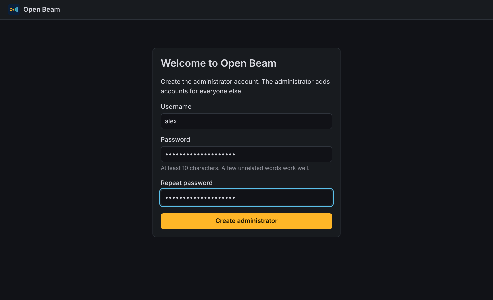
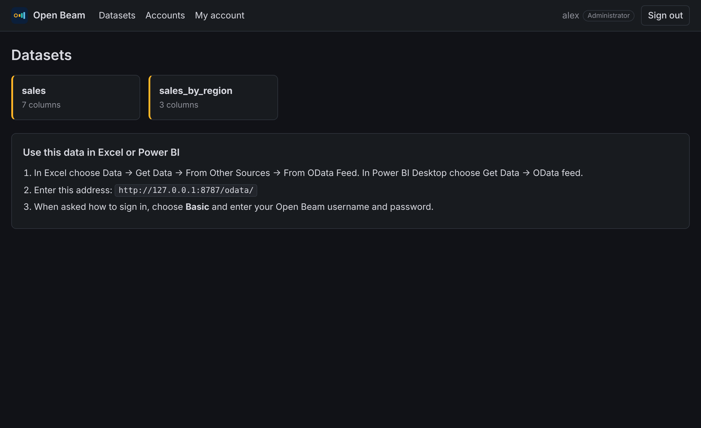
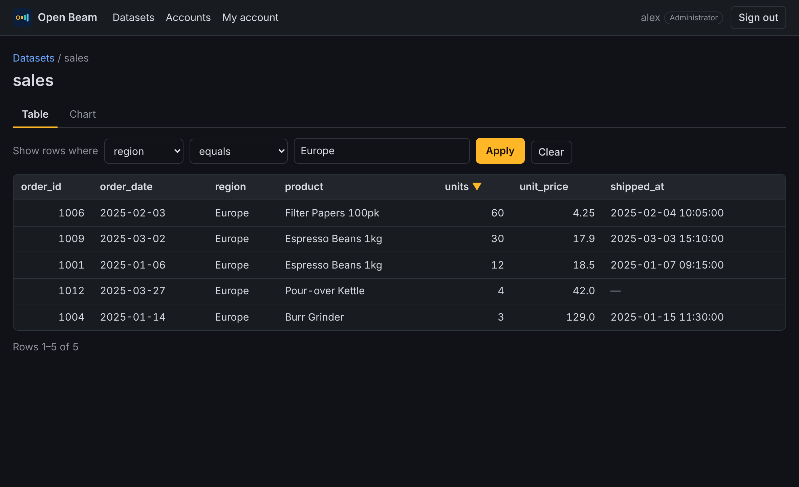
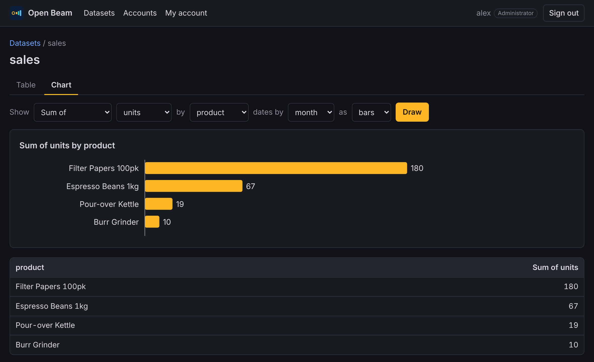

# 2. Start Open Beam and see your data

A *dataset* is a table Open Beam makes available. This guide starts Open Beam
with the included sample, creates your administrator account, and then swaps
in a file of your own.

## Step 1: Create your configuration

Copy the example configuration:

```bash
cp beam.example.toml beam.toml
```

On Windows Command Prompt use `copy beam.example.toml beam.toml`.

It already describes one dataset, the sample file in `examples/sales.csv`:

```toml
[[dataset]]
name = "sales"
path = "examples/sales.csv"
key = "order_id"
```

## Step 2: Start Open Beam

```bash
cargo run --release -- --config beam.toml
```

You should see:

```text
Open Beam 0.2.0 serving 2 dataset(s)
  Open in your browser:        http://127.0.0.1:8787/
  Data feed (Excel, Power BI): http://127.0.0.1:8787/odata/
  No accounts yet. Open the address above to create the administrator.
```

Leave this window open. Press `Ctrl+C` to stop.

## Step 3: Create the administrator account

1. Open <http://127.0.0.1:8787/> in a web browser.
2. Choose a username and a password of at least 10 characters.
3. Select **Create administrator**.



This page appears only once. Afterwards everyone signs in, and the
administrator adds further accounts (see [Manage accounts](05-manage-accounts.md)).

Accounts are stored in `beam-accounts.sqlite`, beside `beam.toml`. That file
is yours: it is not part of the project and Git ignores it.

## Step 4: Look at your data

The home page lists your datasets. Select **sales**.



- Select a column heading to sort by it. Select it again to reverse the order.
- Use **Show rows where** to filter, for example `region` *equals* `Europe`.
- Use **Next** and **Previous** to page through large tables.



## Step 5: Draw a chart

Select **Chart** above the table.

1. Under **Show**, choose what to measure: the number of rows, or the sum,
   average, smallest or largest value of a number column.
2. Under **by**, choose the column to group by.
3. If you group by a date, choose whether **dates** are grouped by day, month,
   quarter or year.
4. Choose **bars** or **a line**, then select **Draw**.



The figures behind the chart are listed underneath it. A filter you set on
the Table view still applies when you switch to the Chart view, so you can
chart just the rows you are looking at.

Bar charts show the 24 largest groups. Line charts show up to 120 points; if
there are more, group dates by a longer period.

## Step 6: Use your own file

1. Create a folder named `data` inside the Open Beam folder and put a CSV or
   Parquet file in it. The `data` folder is ignored by Git, so your files are
   never committed by accident.
2. Add a dataset to `beam.toml`:

   ```toml
   [[dataset]]
   name = "orders"
   path = "data/orders.csv"
   key = "order_id"
   ```

   - `name` is what people will see. Use letters, digits and underscores.
   - `path` is the file, relative to `beam.toml`.
   - `key` is a column whose values are unique and never empty. Leave it out
     if you have none and Open Beam will number the rows in a `_row` column.

3. Stop Open Beam with `Ctrl+C` and start it again.

Column names are tidied so every tool can use them: spaces and symbols become
underscores.

## If something goes wrong

| Message | What to do |
| --- | --- |
| `cannot read beam.toml` | Run the command from the Open Beam folder, or pass the full path with `--config`. |
| `dataset '...': cannot read ...` | Check the `path` and that the file exists. |
| `key column '...' does not exist` | The `key` must match a column header exactly. |
| `cannot listen on 127.0.0.1:8787` | Another program is using the port. Change `bind` to another port such as `127.0.0.1:8788`. |
| The browser shows **Sign in** but you have forgotten the password | See *Locked out* in [Manage accounts](05-manage-accounts.md). |

Next: [Connect Excel and Power BI](03-connect-excel-and-power-bi.md).
