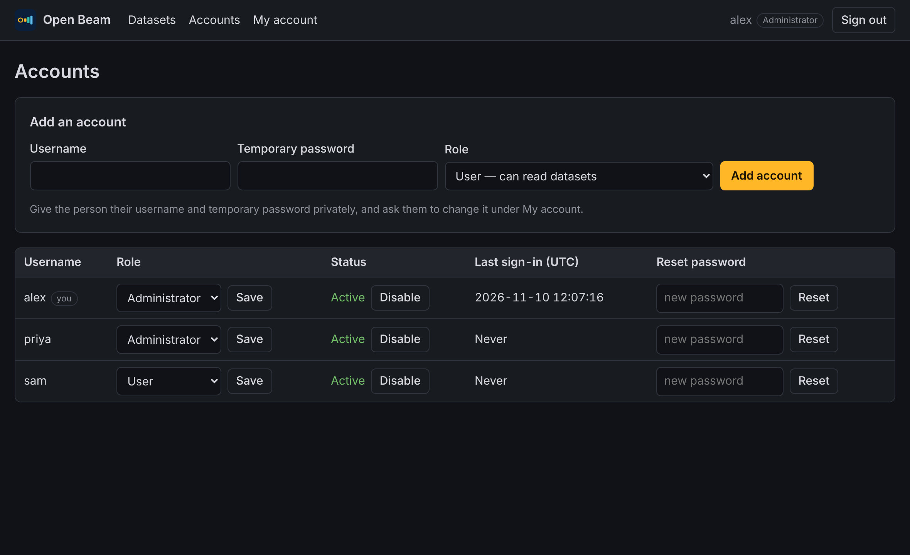

# 5. Manage accounts

Everyone who uses Open Beam signs in with their own account. There are two
roles:

| Role | Can do |
| --- | --- |
| **User** | See every dataset in the browser, and load them into Excel or Power BI. |
| **Administrator** | Everything a user can, plus add accounts, change roles, disable accounts and reset passwords. |

## Add an account

1. Sign in as an administrator and select **Accounts**.
2. Under **Add an account**, enter a username, a temporary password of at
   least 10 characters, and a role.
3. Select **Add account**.
4. Give the person their username and temporary password privately, and ask
   them to change it straight away.



## Change your own password

1. Select **My account**.
2. Enter your current password, then the new one twice.
3. Select **Change password**.

You stay signed in on this device. Every other device is signed out, and
Excel or Power BI will ask for the new password on the next refresh.

## Change a role

In the **Accounts** list, pick the role beside the username and select
**Save**. The change applies to that person's next page.

## Disable or re-enable an account

Select **Disable** beside the account. The person is signed out everywhere at
once and can no longer use the feed. Their account is kept, so **Enable**
restores it.

## Reset a forgotten password

Type a new temporary password in the **Reset password** column and select
**Reset**. The account is signed out everywhere.

## Safeguards

- There is always at least one active administrator. Open Beam refuses to
  demote or disable the last one.
- Five wrong passwords in a row lock that username for a few minutes.
- Sessions end after 12 hours.

## Locked out

If no administrator can sign in, anyone with access to the computer that runs
Open Beam can create a new one. Stop Open Beam, then:

macOS and Linux:

```bash
export BEAM_ADMIN_PASSWORD='choose-a-long-password'
```

```bash
cargo run --release -- --config beam.toml create-admin newadmin
```

Windows PowerShell:

```powershell
$env:BEAM_ADMIN_PASSWORD = 'choose-a-long-password'
```

```powershell
cargo run --release -- --config beam.toml create-admin newadmin
```

Start Open Beam again and sign in with the new account.

Next: [Run Open Beam for a team](06-run-for-a-team.md).
