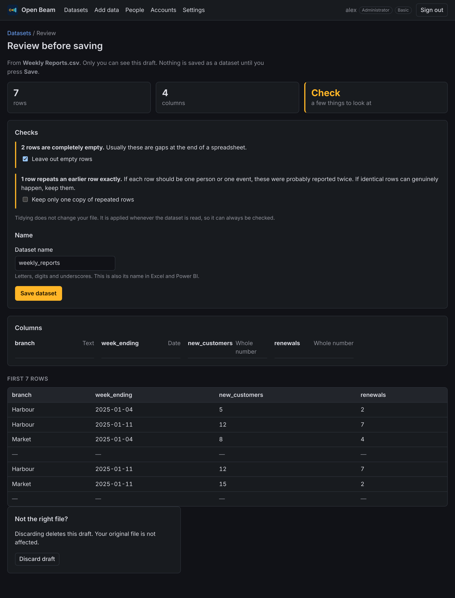
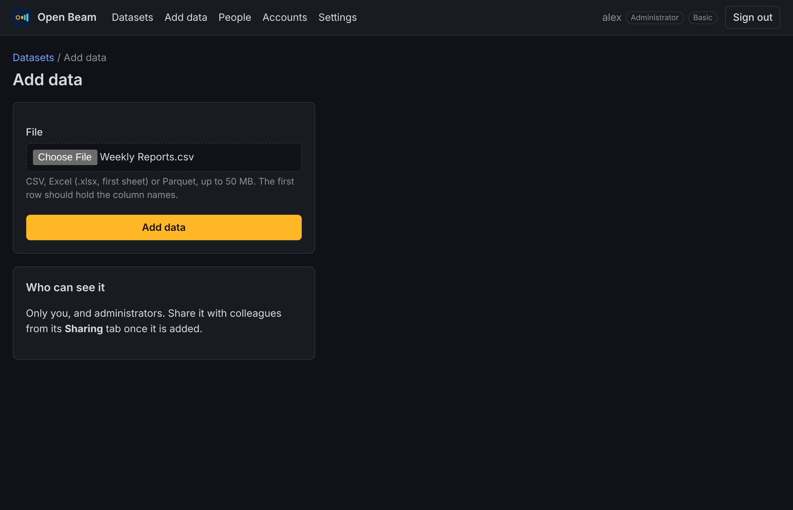
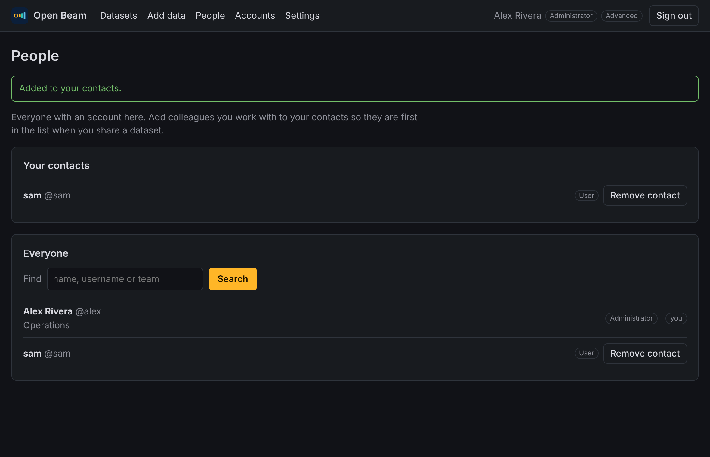

# 7. Add, share and export data

## Add a file

1. Select **Add data**.
2. Choose a file:
   - **CSV** (also `.tsv` and `.txt`)
   - **Excel workbook** (`.xlsx`). The first sheet is used, and dates stay dates.
   - **Parquet**
3. Select **Upload and review**.
4. Check the review page:
   - **Checks** points out rows that are completely empty, rows that repeat
     an earlier row exactly, and columns with no values. Tick what you want
     tidied. Empty rows are ticked for you; repeated rows are left to you,
     because sometimes identical rows are genuine.
   - **Name** is suggested from the file name. Change it if you like.
   - The first rows are shown so you can see the file was read correctly.
5. Select **Save dataset**. Only now does it become a dataset that can be
   charted, shared and opened in Excel or Power BI.

Until you save, the file is a draft that only you can see, not even
administrators. **Discard draft** deletes it. Drafts you neither save nor
discard are deleted after 7 days. Files you haven't reviewed yet are listed on
the Datasets page under **Waiting for your review**.

Tidying never edits your file. It is applied whenever the dataset is read, so
the original is always there.

The first row should hold the column names. Files are limited to 1,000
columns, and to 50 MB by
default; an administrator can change this with `max_upload_mb` in
`beam.toml`.

Open Beam stores its own copy of the file. Changing the original afterwards
does not change the dataset; add the new version as a new dataset.

## Who can see it

A dataset you add is visible to you and to administrators only, until you
share it.

1. Open the dataset and select the **Sharing** tab.
2. Choose a colleague and select **Share**. People in your contacts are listed
   first.
3. To undo, select **Stop sharing** beside their name.

People you share with can view, chart and download the dataset, and load it
into Excel or Power BI. They cannot share it onwards or delete it.

To delete a dataset, use the **Sharing** tab, tick the confirmation and
select **Delete dataset**.

## Contacts

The **People** page lists everyone with an account. Select **Add contact**
beside the colleagues you work with most. Contacts are personal: nobody is told
when you add them.

## Take data somewhere else

Every table has a **Use this data somewhere else** panel.

| To use it in | Do this |
| --- | --- |
| Excel | Select **Download Excel** and open the file. |
| Google Sheets | Select **Download CSV**, then in Sheets choose **File → Import → Upload**. |
| Power BI or Excel, kept up to date | Choose **Get Data → OData feed**, enter the address shown, and sign in with **Basic** using your Open Beam username and password. Refreshing fetches the latest data. |

Downloads contain exactly what is on screen: the same filter, sort and columns,
up to 100,000 rows. For more rows, use the Power BI or Excel connection.

Google Sheets cannot connect live yet: Sheets fetches data from Google's
servers, which cannot sign in to Open Beam on your computer.

In **Advanced** mode the panel also gives the address and a Power Query
formula for exactly the view on screen.

## Known limits when reading files

These are on the list to improve. Until then, check the review page.

- **Text encoding.** Files must be UTF-8 (the usual choice in "Save as CSV
  UTF-8"). Files saved as Latin-1 or "Unicode text" (UTF-16) are refused.
- **A first row of numbers** (for example `2023,2024`) is read as data, not as
  column names, and the columns are named `column0`, `column1`.
- **Dates such as 01/02/2024** are read as day first (1 February 2024). Use
  `2024-02-01` to be unambiguous.
- **Times with a time-zone offset** are kept as text.
- **Excel formulas** are read using the value Excel last saved. A formula that
  was never calculated arrives empty.
- **Excel downloads** are limited by Excel itself to 16,384 columns and 32,767
  characters per cell; Open Beam says so and suggests CSV instead.

